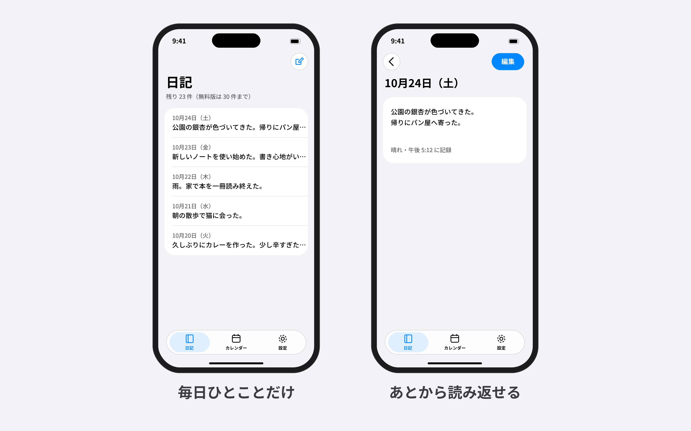
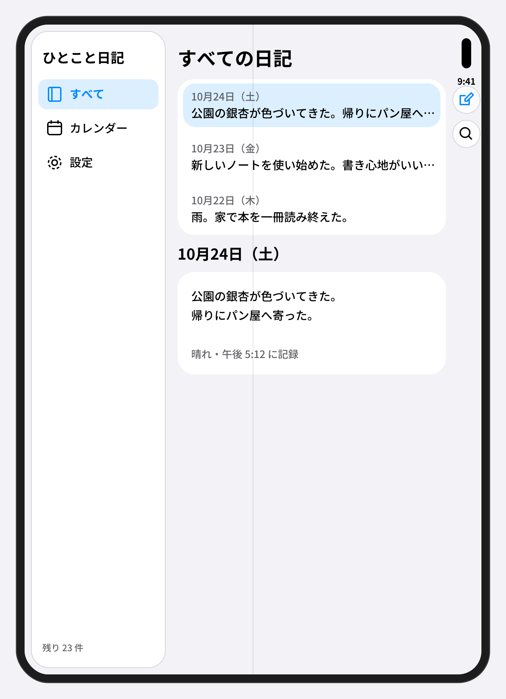

# hig-design-skill

Appleの Human Interface Guidelines（HIG）に沿って、**iPhone / iPhone Duo / iPad / Mac / Apple Watch** のアプリ画面をデザインするAgent Skillです。アプリのアイデアや仕様を渡すと、デザイン設計書と、ライト／ダーク両方のSVGモック＋PNGプレビューを作ります。





- **設計書**： 画面一覧、プラットフォーム別のナビゲーション、全画面の状態（空・エラー・権限拒否・無料版の上限）、色と文字のトークン、SF Symbols、アクセシビリティ
- **モック**： キャンバスは App Store のスクリーンショット寸法に合わせてあり、PNGはそのまま掲載用に使える（透過なし）
- **機械チェック**： キャンバス寸法、最小文字サイズ、文字のコントラスト、ライト／ダークの対、PNGの有無
- **監査**： 仕上げに [design-check-skill](https://github.com/kajisho5/design-check-skill) で、新規の抜けゼロが3パス連続するまで監査する
- サンプルデータは架空のものだけを使う

## インストール

**Claude Code（個人用）** — design-check-skill と一緒に入れます。

```bash
git clone https://github.com/kajisho5/hig-design-skill ~/.claude/skills/hig-design-skill
git clone https://github.com/kajisho5/design-check-skill ~/.claude/skills/design-check-skill
pip install -r ~/.claude/skills/hig-design-skill/requirements.txt
```

**Claude Code（プロジェクト用）** — リポジトリ直下で：

```bash
git clone https://github.com/kajisho5/hig-design-skill .claude/skills/hig-design-skill
git clone https://github.com/kajisho5/design-check-skill .claude/skills/design-check-skill
```

その他のスキル対応エージェントでは、このフォルダをそのエージェントのスキル置き場に配置してください（[Agent Skills の仕様](https://agentskills.io/specification)に準拠）。

PNGの書き出しには和文の書体が必要です（Macはヒラギノで可。Linuxは Noto Sans CJK JP を入れる）。

## 使い方

依頼の例：

- 「家計簿アプリの画面を iPhone と iPad でデザインして」
- 「この仕様のアプリを HIG に沿ってモックにして。Mac と Watch も」
- 「App Store に載せるスクショ用のモックを作って。iPhone Duo（折りたたみ）の外側と内側も」

できあがるもの：

```
design/
  design-spec.md
  mocks/
    iphone-S-01-light.svg / .png   … 各画面 × ライト／ダーク
    iphone-duo-outer-S-01-light.png … iPhone Duo 外側（閉じた状態）
    iphone-duo-inner-S-01-light.png … iPhone Duo 内側（開いた状態）
    ipad-landscape-S-01-light.png
    mac-S-01-light.png
    watch-ultra-S-01.png
```

スクリプトは単体でも使えます。

```bash
python3 scripts/frame.py duo-inner design/mocks/iphone-duo-inner-S-01-light.svg -o design/mocks/framed-iphone-duo-inner-S-01-light.svg
python3 scripts/frame.py pair left.svg right.svg -o pair-S-01-S-02-light.svg --caption-left "見出し" --caption-right "見出し"
python3 scripts/export_png.py design/mocks
python3 scripts/check_mocks.py design/mocks
```

## できること／できないこと

できること：
- HIGに沿った画面設計とモック制作（iPhone / iPhone Duo / iPad / Mac / Apple Watch、ライト／ダーク）
- App Store のスクリーンショット寸法でのPNG書き出し
- 寸法・文字サイズ・コントラストの機械チェックと、design-check-skill による監査

できないこと：
- アプリのコード実装
- 実在の人物・住所・企業・他社アプリの画面を使ったモック
- Appleの実機を精密に描いた端末フレーム（同梱のフレームは汎用の角丸形状です）

## ファイル構成

- `SKILL.md` — ワークフローとデザインの原則
- `references/hig-specs.md` — キャンバス寸法、Text Styles、コントロール、コントラスト、色の近似値、ナビゲーションの型（出典つき）
- `templates/design-spec.md` — 設計書の雛形
- `scripts/` — `devices.py`（端末と寸法）、`frame.py`（端末フレーム・2台並び）、`export_png.py`（PNG書き出し）、`check_mocks.py`（機械チェック）
- `examples/hitokoto/` — 完成例（架空のアプリ「ひとこと日記」）。`bash examples/hitokoto/make.sh` で全モックを作り直して検査できる
- `requirements.txt` — スクリプトの依存（cairosvg、pillow）
- `.github/workflows/check.yml` — 完成例の再生成・検査と、SKILL.md の形式チェックを GitHub Actions で実行
- `LICENSE` — MIT License

## よくある質問

**Q. 寸法の根拠は？**
A. キャンバスは App Store Connect のスクリーンショット仕様（ピクセル）を端末の倍率で割ったものです。文字・コントロール・コントラストは HIG の Typography と Accessibility の値です。`references/hig-specs.md` に出典と確認日があります。

**Q. 色の値は正確ですか？**
A. モックに書く色は近似値です。HIGは色見本を画像で載せているため、正確な値は Apple Design Resources で確認してください。実装ではシステムカラーを使う前提で、設計書にはシステムカラーの名前を書きます。

**Q. iPhone Duo には対応していますか？**
A. はい。2026年9月発表の折りたたみ iPhone で、外側（5.4インチ）と内側（7.6インチ）の両方のモックを作ります。キャンバスは App Store のスクリーンショット仕様（外側 1398 × 2034 px、内側 2007 × 2853 px）に合わせています。pt寸法・Split View の幅・Dynamic Island の正確な位置はAppleが公開していないため、推定値・近似として扱います。iPhone Duo のスクリーンショットは現時点では任意ですが、2027年4月以降は iOS 27.1 SDK 以降でビルドしたアプリで必須になります。

**Q. design-check-skill は必須ですか？**
A. 推奨です。無い環境では簡易チェックで代え、設計書に「監査は未実施」と書きます。

## 出典

- [Apple Human Interface Guidelines](https://developer.apple.com/design/human-interface-guidelines)
- [Screenshot specifications（App Store Connect）](https://developer.apple.com/help/app-store-connect/reference/app-information/screenshot-specifications)
- [Apple Design Resources](https://developer.apple.com/design/resources/)
- [Prepare your app for iPhone Duo（Apple Developer Tech Talk）](https://developer.apple.com/videos/play/tech-talks/111461/)

## 関連プロジェクト

- [design-check-skill](https://github.com/kajisho5/design-check-skill) — デザインの抜け監査（このスキルの仕上げに使います）
- [fresnel](https://github.com/kajisho5/fresnel) — Liquid Glass アイコン作成ツール

## ライセンス

MIT License（`LICENSE` を参照）
